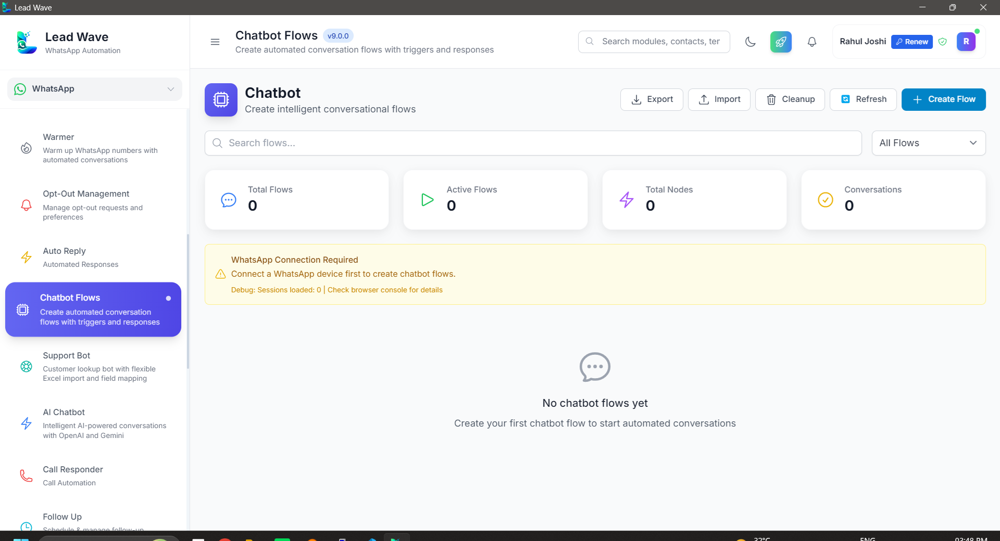
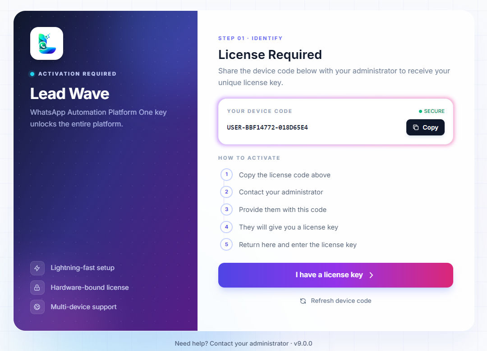
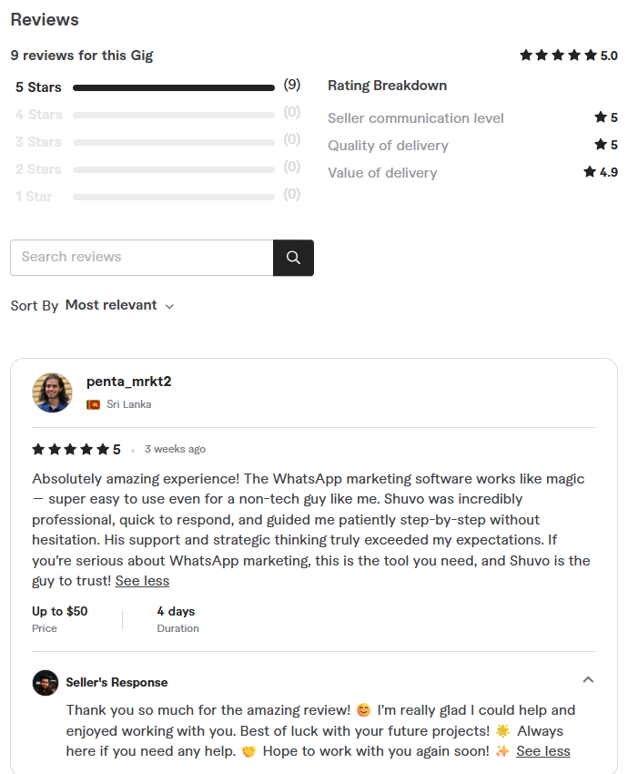
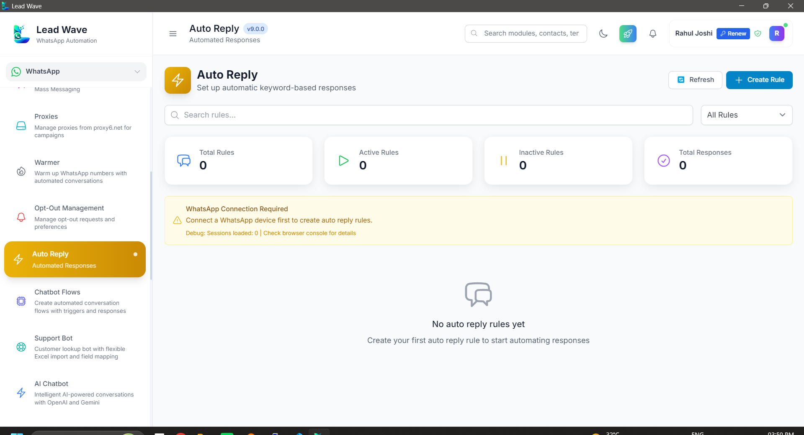

# 🚀 LeadWave — WhatsApp Interactive Buttons & Marketing Automation

### WhatsApp Quick Reply Buttons | Auto Replies & Chat Flows | Multi-Account Software for Windows

**Share a catalogue • Offer a coupon • Start a call • Follow up with a lead**

  

 

### 🎉 Try LeadWave on your Windows PC

*Connect your number and test your first interactive message on a phone.*

 

 

---

## ⚡ Give customers a next step inside WhatsApp

# 👉 [**DOWNLOAD LEADWAVE FOR WINDOWS**](https://leadwave-pro.vercel.app/) 👈

### 🎁 Get the installer and request your free trial key from Shuvo.

[leadwave-pro.vercel.app](https://leadwave-pro.vercel.app/)

---

 

## 📖 About LeadWave

Give customers a way to act on an offer while they are reading it. With LeadWave, a shop can send a WhatsApp message with a catalogue link, offer a coupon customers can copy at checkout, or let someone call the store. A quick reply can start a different conversation for each enquiry.

LeadWave connects through WhatsApp Web and charges no per-message fee.

 

## ✨ Key Features

<table>
<tr>
<td width="50%" valign="top">

**📨 Interactive buttons**

- Quick reply to request prices
- Website link to open a catalogue
- Copy a discount coupon
- Click to call the store

</td>
<td width="50%" valign="top">

**👥 Account management**

- Connect unlimited WhatsApp accounts
- Choose the number for each campaign

</td>
</tr>
<tr>
<td width="50%" valign="top">

**⚡ Auto replies & chat flows**

- Match replies to keywords
- Build a separate flow for each incoming message

</td>
<td width="50%" valign="top">

**🎯 Lead tracking**

- Tag contacts who asked for a quote
- Review conversation history before following up

</td>
</tr>
<tr>
<td width="50%" valign="top">

**👥 Group management**

- Organize contacts and groups
- Select the audience for each update

</td>
<td width="50%" valign="top">

**🗓️ Campaigns**

- Schedule personalized bulk messages
- Reuse templates for your next offer

</td>
</tr>
</table>

 

## 🖼️ Sneak Peek

**Message Templates** — Add a “Choose a size” button that opens your product page or a coupon button that copies an offer code.

  

**Chatbot Builder** — Give “See prices” and “Ask about delivery” their own follow-up messages.

 

## 🔑 Trial & License Activation

<table>
<tr>
<td width="50%" valign="top">

**🖥️ On your Windows PC**

- Install LeadWave and open the activation screen.
- Copy the device code shown for your computer.

</td>
<td width="50%" valign="top">

**💬 With Shuvo on WhatsApp**

- Send your device code to request a trial key.
- Enter the key in LeadWave and connect your number.

</td>
</tr>
</table>

**License activation** — Your own device code appears in the field beside the Copy button.

 

## 💼 Who Is This For?

| Audience | Example |
| --- | --- |
| 🛍️ Retailers | Put a coupon code or catalogue link in an offer. |
| 📞 Local businesses | Let a customer call the showroom from a message. |
| 💬 Support teams | Answer delivery questions with keyword-based auto replies. |
| 🤝 Sales teams | Track quote requests and follow up from the right account. |

 

## ⚙️ Getting Started

1. [Open the Windows download page](https://leadwave-pro.vercel.app/), then install LeadWave and open it.
2. Copy the device code shown on first launch. [Contact activation support](https://wa.me/919641700503) for a trial key, then enter the key in the app.
3. Connect your WhatsApp number. Create one template and send it to a test contact. Tap the button on the receiving phone to check the destination or reply.

📘 [Download the LeadWave setup guide](./LeadWave-Setup-Guide.pdf)

 

## 📌 Important Notes

> WhatsApp may restrict accounts using unofficial automation. Send campaigns to contacts who opted in and honor opt-outs.

## 📥 Get Full Access

**For a trial key, purchase enquiry or setup help, contact Engr Shuvo Das.**

 

**WhatsApp** +91 9641700503 · **Email** engrshuvoda@gmail.com

 

---

## 🌍 Client Reviews

**Read reviews of Shuvo’s WhatsApp software work on Fiverr.**

[View Shuvo’s Fiverr reviews](https://www.fiverr.com/s/VYZLokm)

 

---

## 📺 Demos & Tutorials

**Auto Reply** — Choose *Create Rule* to match an incoming keyword such as “delivery” to a saved answer.

[Watch Shuvo’s tutorials](https://www.youtube.com/@engr_shuvo) · [Read the LeadWave setup guide](./LeadWave-Setup-Guide.pdf)

---

## ❓ Frequently Asked Questions

<strong>Where can I get the Windows installer and trial key?</strong>

Visit the [LeadWave download page](https://leadwave-pro.vercel.app/) for the installer. After first launch, send your device code to Shuvo on WhatsApp for activation.

<strong>What happens when someone taps a quick reply?</strong>

The button sends its label back as the customer's reply. Match “See prices” to a keyword auto reply to send your price list, or use it to start a longer chat flow.

<strong>Can a customer copy a coupon or call my store?</strong>

Yes. A coupon button copies the offer code for checkout. A click-to-call button opens the phone dialler with your store number.

<strong>Do I need a WhatsApp Business API account?</strong>

LeadWave connects to your existing WhatsApp number through WhatsApp Web. You can use interactive buttons without registering for the WhatsApp Business API.

 

---

### **Engr Shuvo Das**

| Platform | Link |
|:---|:---|
| 💬 **WhatsApp** | [Chat Now](https://wa.me/+919641700503) |
| 💼 **LinkedIn** | [Profile](https://www.linkedin.com/in/engrshuvoda/) |
| 📺 **YouTube** | [Channel](https://www.youtube.com/channel/UCEJ0R871tF2PLT27q9azYWg) |
| 🧑‍💻 **GitHub** | [Repositories](https://github.com/engrshuvodas) |
| 🟢 **Fiverr** | [Hire Me](https://www.fiverr.com/shuvo_das74886) |
| 🌐 **Portfolio** | [About Me](https://engrshuvodas.github.io/me/) |
| ✉️ **Email** | [engrshuvoda@gmail.com](mailto:engrshuvoda@gmail.com) |
| 🐦 **X (Twitter)** | [@engrshuvodas](https://x.com/engrshuvodas) |
| 📘 **Facebook** | [Engr Shuvo](https://www.facebook.com/engr.shuvo74886/) |

 

---

**Related searches:** LeadWave download for Windows · WhatsApp interactive button messages · WhatsApp quick reply buttons · WhatsApp website link button · WhatsApp copy coupon code button · WhatsApp click-to-call button · WhatsApp buttons without Business API · WhatsApp auto reply software · WhatsApp chatbot flow builder · WhatsApp group management software · WhatsApp lead tracking software · multi-account WhatsApp bulk sender · WhatsApp marketing automation for Windows

