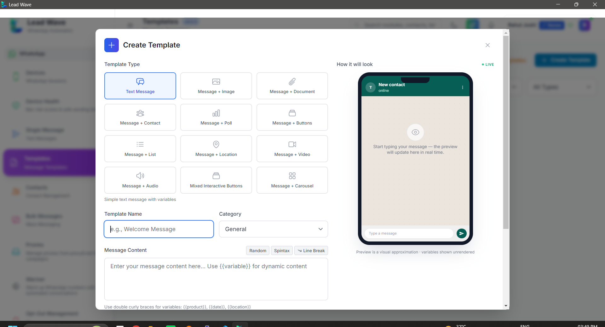

# LeadWave for Windows — WhatsApp interactive buttons and auto replies

Give customers a way to act on an offer while they are reading it. With LeadWave, a shop can send a WhatsApp message with a catalogue link, offer a coupon customers can copy at checkout, or let someone call the store. A quick reply can start a different conversation for each enquiry.

[Request the Windows installer on WhatsApp](https://wa.me/919641700503?text=Hi%2C%20please%20send%20me%20the%20LeadWave%20Windows%20installer.) · [Read the setup guide](./LeadWave-Setup-Guide.pdf) · [Request a trial key](https://wa.me/919641700503?text=Hi%2C%20I%27d%20like%20a%20LeadWave%20trial%20key.)

## Which WhatsApp button fits your message?

| Customer action | Button type | Example |
| --- | --- | --- |
| Ask for information | Quick reply | “Send pricing” sends a reply that can trigger your price list. |
| Browse a product | Website link | “Choose a size” opens the product page. |
| Redeem a discount | Copy coupon code | “Copy code” puts WEEKEND10 on the clipboard for checkout. |
| Speak to your team | Click to call | “Call the showroom” opens the dialler with your number. |

## Turn a reply into a follow-up

For a weekend offer, create two quick replies, **See prices** and **Ask about delivery**. Set a keyword auto reply for each response. Send a price list to the first customer and ask the second for their delivery area. Use the chatbot builder when a conversation needs another question or a different next step.

## Manage campaigns, groups and leads

- **WhatsApp bulk messaging** — Schedule a personalized message for contacts who signed up for an offer. Reuse templates for the next campaign.
- **Group management** — Organize contacts and groups so a customer update reaches the intended audience.
- **Lead tracking** — Review conversation history and tags before following up with someone who requested a quote.
- **Multi-account management** — Connect unlimited WhatsApp accounts in the desktop app and choose the appropriate number for each campaign.

## Download and activate LeadWave

1. [Message Shuvo for the Windows installer](https://wa.me/919641700503?text=Hi%2C%20please%20send%20me%20the%20LeadWave%20Windows%20installer.), then install LeadWave and open it.
2. Copy the device code shown on first launch. [Contact activation support](https://wa.me/919641700503) for a trial key, then enter the key in the app.
3. Connect your WhatsApp number. Create one template and send it to a test contact. Tap the button on the receiving phone to check the destination or reply.

**Do I need the WhatsApp Business API?** LeadWave connects through WhatsApp Web. You can use interactive button messages without registering for the WhatsApp Business API. LeadWave charges no per-message fee. WhatsApp may restrict accounts using unofficial automation. Message people who opted in and honor opt-outs.

[Contact Shuvo on WhatsApp](https://wa.me/919641700503) · [Email Shuvo](mailto:engrshuvoda@gmail.com)

## Related searches

LeadWave download for Windows · WhatsApp interactive button messages · WhatsApp quick reply buttons · WhatsApp website link button · WhatsApp copy coupon code button · WhatsApp click-to-call button · WhatsApp buttons without Business API · WhatsApp auto reply software · WhatsApp chatbot flow builder · WhatsApp group management software · WhatsApp lead tracking software · multi-account WhatsApp bulk sender · WhatsApp marketing automation for Windows
